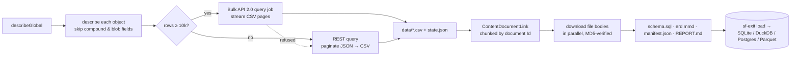

<div align="center">

# sf-exit

**Leave Salesforce with all of your data.**

One command exports every record, file and attachment from a Salesforce org,<br>
then loads it into **SQLite, DuckDB, Postgres or Parquet**, with every Id and relationship kept.

[](https://github.com/akhsterminator/sf-exit/actions/workflows/ci.yml)
[](https://pypi.org/project/sf-exit/)
[](https://pypi.org/project/sf-exit/)
[](LICENSE)
[](https://github.com/akhsterminator/sf-exit/stargazers)

[Quick start](#quick-start) · [What you get](#what-you-get) · [Why](#why-sf-exit) · [Nightly backups](#nightly-backups-with-github-actions) · [FAQ](#faq) · [Roadmap](#roadmap)


<sub>A real run, recorded against the simulated org that the test suite uses (<code>scripts/record_demo.py</code>).</sub>

</div>

---

## Quick start

```bash
pipx install sf-exit                      # or: pip install sf-exit / uvx sf-exit
sf org login web --alias my-org           # log in once with the Salesforce CLI
sf-exit export --org my-org -d ./export   # every object + every file
sf-exit load ./export --to duckdb:///salesforce.duckdb
```

That's it. There's no connected app to configure and no Salesforce setup to change: sf-exit reuses your [Salesforce CLI](https://developer.salesforce.com/tools/salesforcecli) login. Other login methods (access token, JWT, OAuth client credentials, username + password) are covered [below](#authentication).

Not sure what you're in for? Run a **dry run** first:

```bash
sf-exit plan --org my-org     # objects, row counts, file storage, API calls needed vs. your limits
sf-exit doctor --org my-org   # checks you have "View All Data" and "Query All Files"
```

## What you get

```text
export/
├── data/
│   ├── Account.csv               ← one CSV per object, every field, original 18-char Ids
│   ├── Contact.csv
│   ├── Invoice__c.csv            ← custom objects too
│   ├── ContentDocumentLink.csv   ← which file belongs to which record
│   └── … (every queryable object: history, tasks, emails, chatter, custom metadata…)
├── files/
│   ├── ContentVersion/<ContentDocumentId>/v1_Contract.pdf
│   ├── Attachment/<ParentId>/<Id>_logo.png
│   ├── Document/<FolderId>/<Id>_Letterhead.docx
│   └── index.csv                 ← file → record mapping, SHA-256, MD5 checked against Salesforce
├── schema/Account.json           ← full describe: labels, picklist values, relationships
├── schema.postgres.sql           ← ready-to-run DDL (also .duckdb.sql / .sqlite.sql)
├── erd.mmd                       ← Mermaid diagram of your data model
├── manifest.json                 ← counts + checksums, machine-readable
└── REPORT.md                     ← human summary: what was exported, what was skipped and why
```

Then query it however you like:

```sql
-- duckdb salesforce.duckdb
SELECT a.Name, count(*) AS open_opps, sum(o.Amount) AS pipeline
FROM Opportunity o JOIN Account a ON a.Id = o.AccountId
WHERE NOT o.IsClosed
GROUP BY 1 ORDER BY pipeline DESC LIMIT 10;
```

## Why sf-exit

Your CRM data belongs to you, but getting *all* of it out of Salesforce in a usable form is surprisingly hard.

|                                             | **sf-exit** | Data Export Service | Data Loader | Paid backup tools |
|---------------------------------------------|:---:|:---:|:---:|:---:|
| Every object in one run                     | ✅ | ✅ | ❌ one at a time | ✅ |
| Files, attachments & documents, linked to records | ✅ | ✅ zipped | ❌ | ✅ |
| Run whenever you want                       | ✅ | ❌ weekly or monthly | ✅ | ✅ |
| Resumes after interruption                  | ✅ | ❌ | ❌ | varies |
| Typed SQL schema + relationships            | ✅ | ❌ | ❌ | rarely |
| Loads into Postgres / DuckDB / SQLite / Parquet | ✅ | ❌ | ❌ | rarely |
| Checksums + verify against the live org     | ✅ | ❌ | ❌ | varies |
| Scriptable / CI-friendly                    | ✅ | ❌ | partly | API only |
| Data never leaves your machine              | ✅ | ✅ | ✅ | ❌ stored by vendor |
| Price                                       | **free, MIT** | included | free | $$ per user / month |

Use it to **migrate** to another CRM, **archive** an org before you shut it down, take **independent backups**, or feed a **data warehouse**.

## Features

- **Complete by default.** It finds every queryable object (standard, custom, history, activities, Chatter, email, custom metadata) and every field. It also explains anything it skips in `REPORT.md`.
- **Fast on big orgs and light on API limits.** Large objects go through **Bulk API 2.0**, several at a time. Small objects are described and fetched **25 per API call** using composite requests, so a typical org's hundreds of small objects cost dozens of calls, not a thousand. If Bulk refuses an object, it falls back to REST.
- **Handles Salesforce's quirks.** Knowledge articles (`__kav`, which need a status filter) and `ContentDocumentLink` (which needs an Id filter) are exported anyway. System objects that can't be exported are skipped with the reason, instead of failing your run.
- **Files that stay connected.** ContentVersion, Attachment and Document bodies are downloaded in parallel, checked against Salesforce's own MD5 checksum, and mapped back to their records via `ContentDocumentLink` and `files/index.csv`.
- **Resumable.** Press Ctrl-C, lose Wi-Fi or hit an API limit, then run the same command again. Finished objects and files are skipped.
- **Deleted and archived records** with `--include-deleted` (Recycle Bin, archived activities).
- **Real schemas.** Typed DDL for Postgres, DuckDB and SQLite, plus a Mermaid ER diagram. `sf-exit load` creates typed tables: dates are dates, booleans are booleans, currency is numeric.
- **Verifiable.** `sf-exit verify` re-counts every CSV and re-hashes every file. `--live` compares counts against the org.
- **Read-only and private.** sf-exit never modifies your org and has no telemetry. Data goes straight from Salesforce to your disk.
- **Plays well with others.** It's a plain folder of CSVs. Also available as a pip package, a Docker image and a GitHub Action.

## Usage

### Authentication

| Method | Command | Best for |
|---|---|---|
| Salesforce CLI | `sf-exit export --org my-alias` | Laptops. Zero setup. If you omit `--org`, your default CLI org is used |
| Access token | `--instance-url https://acme.my.salesforce.com --access-token 00D…` | One-offs, other tools |
| OAuth client credentials | `--instance-url … --client-id … --client-secret …` | Servers, CI ([setup](docs/authentication.md#client-credentials)) |
| JWT bearer | `--client-id … --username … --jwt-key-file server.key` | CI with a certificate (`pip install 'sf-exit[jwt]'`) |
| Username + password | `--client-id … --client-secret … -u … --password 'pw+token'` | Legacy setups |

Every flag can also be set as an environment variable (`SF_ORG`, `SF_INSTANCE_URL`, `SF_ACCESS_TOKEN`, `SF_CLIENT_ID`, `SF_CLIENT_SECRET`, `SF_USERNAME`, `SF_PASSWORD`, `SF_JWT_KEY_FILE`). Add `--sandbox` for test.salesforce.com logins. More detail is in [docs/authentication.md](docs/authentication.md).

> **Permissions:** for a complete export the user should have **View All Data** and **Query All Files**. Without them, Salesforce silently returns only the records and files that user can see. `sf-exit doctor` checks this for you.

### Choosing what to export

```bash
sf-exit export -i Account -i Contact -i 'Invoice*__c'   # only these (globs, case-insensitive)
sf-exit export -x '*History' -x '*Share' -x '*Feed'     # everything except these
sf-exit export --include-deleted                        # + Recycle Bin and archived records
sf-exit export --no-files                               # records only
sf-exit export --files-only --all-file-versions         # every version of every file
```

### Loading into a database

```bash
sf-exit load ./export --to sqlite:///salesforce.db                     # built in
sf-exit load ./export --to duckdb:///salesforce.duckdb                 # pip install 'sf-exit[duckdb]'
sf-exit load ./export --to parquet:///./parquet                        # pip install 'sf-exit[parquet]'
sf-exit load ./export --to postgresql://me:pw@localhost/crm --lowercase  # pip install 'sf-exit[postgres]'

sf-exit export --org my-org --load duckdb:///salesforce.duckdb         # export + load in one go
```

Use `pip install 'sf-exit[all]'` to get every extra.

### Verifying an export

```bash
sf-exit verify ./export          # offline: CSV row counts + SHA-256 of every data file and binary file
sf-exit verify ./export --live   # also compare row counts against the org right now
```

### Docker

```bash
docker run --rm -it -v "$PWD:/work" -e SF_INSTANCE_URL -e SF_ACCESS_TOKEN \
  ghcr.io/akhsterminator/sf-exit export -d /work/export
```

## Nightly backups with GitHub Actions

sf-exit ships as a GitHub Action. Put this in a **private** repository and you have free, versioned, off-platform Salesforce backups:

```yaml
# .github/workflows/salesforce-backup.yml
on:
  schedule: [{ cron: "0 2 * * *" }]
  workflow_dispatch:
jobs:
  backup:
    runs-on: ubuntu-latest
    steps:
      - uses: akhsterminator/sf-exit@v0
        with:
          args: export -d sf-export --load parquet:///sf-parquet
        env:
          SF_INSTANCE_URL: ${{ secrets.SF_INSTANCE_URL }}
          SF_CLIENT_ID: ${{ secrets.SF_CLIENT_ID }}
          SF_CLIENT_SECRET: ${{ secrets.SF_CLIENT_SECRET }}
      - uses: actions/upload-artifact@v7
        with: { name: salesforce-backup, path: sf-export, retention-days: 30 }
```

There's a fuller example, including upload to S3, in [examples/github-actions-backup.yml](examples/github-actions-backup.yml).

## How it works



## FAQ

<details><summary><b>Will this use up my API limits?</b></summary>

Usually not by much. A Bulk API job costs a handful of calls whatever its size. Small objects are fetched 25 per call, and each file costs one call. `sf-exit plan` estimates the total and shows your remaining daily allowance before you start. Use `--workers 1` to go gently on a busy org.
</details>

<details><summary><b>How long does it take?</b></summary>

It depends mostly on Salesforce's Bulk API and your file storage. As a rough guide, millions of records take minutes to tens of minutes, and file downloads are limited by bandwidth. Because exports resume, a long run can be spread over several sessions.
</details>

<details><summary><b>Does it export metadata (Apex, flows, layouts, reports)?</b></summary>

Not yet. sf-exit focuses on **data**, but it does save each object's schema (fields, picklists, relationships) as JSON and SQL. For metadata, use `sf project retrieve start --manifest package.xml` today. Native support is on the [roadmap](#roadmap).
</details>

<details><summary><b>Which editions are supported?</b></summary>

Any org with API access: Enterprise, Unlimited, Performance and Developer editions, plus Professional Edition with the API add-on. Sandboxes work with `--sandbox` or a sandbox CLI alias.
</details>

<details><summary><b>Why are some objects skipped?</b></summary>

Some "objects" are really metadata views (`FieldDefinition`), virtual roll-ups of data exported elsewhere (`OpenActivity`, `CombinedAttachment`), streaming events (`*ChangeEvent`), external objects (`__x`) or big objects (`__b`). Every skip and its reason is listed in `REPORT.md`. Run with `-v` to see them in `sf-exit plan`.
</details>

<details><summary><b>What about compound fields like addresses?</b></summary>

The Bulk API can't return compound fields, so sf-exit exports their components instead: `BillingStreet`, `BillingCity`, `BillingPostalCode` and so on. No data is lost.
</details>

<details><summary><b>Is my data sent anywhere?</b></summary>

No. sf-exit talks only to your Salesforce instance and writes only to your disk. There's no telemetry, no account and no server.
</details>

<details><summary><b>Can I put the data back into Salesforce, or into another CRM?</b></summary>

The export keeps every original Id and relationship column, which is exactly what you need to rebuild links in a target system. Guided re-import into another org, HubSpot or Attio is on the roadmap, and recipes are very welcome as PRs.
</details>

## Roadmap

- [ ] Incremental exports (only changed rows, via `SystemModstamp`)
- [ ] Metadata export (Apex, flows, layouts, reports) via the Metadata API
- [ ] Write straight to S3 / GCS / Azure Blob
- [ ] Import helpers: Salesforce → another Salesforce org, HubSpot, Attio, Twenty
- [ ] Field-level PII redaction for sharing exports safely
- [ ] Big object (`__b`) export
- [ ] Single-file binaries (Homebrew, Scoop)

Have an idea or need? [Open an issue](https://github.com/akhsterminator/sf-exit/issues/new/choose). Good first issues are [labelled](https://github.com/akhsterminator/sf-exit/labels/good%20first%20issue).

## Contributing

Contributions are welcome! The whole test suite runs against an in-process **fake Salesforce org** (`tests/fake_org.py`), so you don't need a Salesforce account to hack on sf-exit:

```bash
git clone https://github.com/akhsterminator/sf-exit && cd sf-exit
pip install -e '.[dev]'
pytest
```

See [CONTRIBUTING.md](CONTRIBUTING.md) for details.

## Star history

If sf-exit saved you a migration project or a backup bill, a ⭐ helps other people find it.

[](https://star-history.com/#akhsterminator/sf-exit&Date)

## License

[MIT](LICENSE). sf-exit is an independent open-source project and is not affiliated with, endorsed by or sponsored by Salesforce, Inc. Salesforce is a trademark of Salesforce, Inc.
