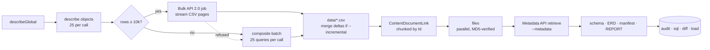

<div align="center">

# sf-exit

### Leave Salesforce with all of your data. Or just stop paying to back it up.

One open-source CLI to **export** every record, file and piece of configuration from a Salesforce org, **audit** what's actually in it, **back it up** every night, and **load** it anywhere: DuckDB, Postgres, SQLite or Parquet.

[](https://github.com/akhsterminator/sf-exit/actions/workflows/ci.yml)
[](https://pypi.org/project/sf-exit/)
[](https://pypi.org/project/sf-exit/)
[](LICENSE)
[](https://github.com/akhsterminator/sf-exit/stargazers)

[Quick start](#quick-start) · [Audit](#see-whats-really-in-your-org) · [Backups](#nightly-backups-for-free) · [Migrate](docs/recipes/migrate-to-another-crm.md) · [Commands](docs/commands.md) · [FAQ](#faq)


<sub>Real runs, recorded against the simulated org that the test suite uses (<code>scripts/record_demo.py</code>).</sub>

</div>

---

## What it does

|  |  |
|---|---|
| 📦 **Export everything** | Every object, record and field, plus files, attachments and the links between them, from any org. Bulk API 2.0 for big objects and batched REST for small ones. Resumable. [→](docs/commands.md#export) |
| 🧬 **Export the configuration** | Apex, Flows, objects, layouts, reports, dashboards and permission sets as a deployable Metadata API folder. [→](docs/commands.md#metadata) |
| 🩺 **Audit your org** | An HTML data dictionary plus health findings: unused fields, duplicates, stale pipeline, orphaned records. Works offline. [→](docs/audit.md) |
| 🔁 **Back up incrementally** | Nightly runs fetch only what changed or was deleted. `sf-exit diff` shows exactly what changed between two backups. [→](docs/recipes/nightly-backups.md) |
| 🔎 **Query it instantly** | `sf-exit sql ./export "SELECT …"`: typed SQL over the export with no load step. [→](docs/commands.md#sql) |
| 🚚 **Load it anywhere** | DuckDB, Postgres, SQLite or Parquet with real column types, plus generated DDL and an ER diagram. [→](docs/commands.md#load) |
| 🔐 **Share it safely** | `--redact-pii` hashes emails, phones and other PII consistently, so joins and dedupe still work. [→](docs/commands.md#export) |

**Read-only. No telemetry. No servers.** Data goes straight from Salesforce to your disk.

## Quick start

```bash
pipx install 'sf-exit[duckdb]'               # or: pip install / uvx sf-exit
sf org login web --alias my-org              # log in once with the Salesforce CLI
sf-exit export --org my-org -d ./export --metadata --audit
```

That gives you every record, file and piece of configuration, plus an org health report at `./export/audit/index.html`. There's no connected app to set up: sf-exit reuses your [Salesforce CLI](https://developer.salesforce.com/tools/salesforcecli) login. Other login methods (token, JWT, client credentials) are covered in [docs/authentication.md](docs/authentication.md).

Not sure what you're in for? `sf-exit plan --org my-org` estimates sizes and API calls, and `sf-exit doctor --org my-org` checks your permissions. Both are read-only.

## See what's really in your org

`sf-exit audit` reads an export and builds a **searchable data dictionary** and an **org health report**, entirely offline. It answers the questions every admin, consultant and migration project asks first.

<p align="center"></p>

- **Which custom fields does nobody use?** Fill rate for every field, flagging never-filled fields, never-ticked checkboxes and picklist values nobody picks.
- **How dirty is the data?** Duplicate contacts and leads by email, duplicate accounts by normalised company name, contacts with no account.
- **What's rotting?** Open opportunities past their close date (with the total amount), records owned by deactivated users, custom objects nobody has touched in a year.
- **What is this field even for?** Labels, types, help text, picklist values, lookup targets and date ranges for every object.

<p align="center"></p>

The report is a single self-contained HTML file you can email, plus `data-dictionary.csv` for Excel, `findings.md` for tickets and `audit.json` for automation. [What each finding means →](docs/audit.md)

## Nightly backups, for free

Salesforce charges extra for backup, and third-party tools charge per user per month. sf-exit does it with a cron job or a scheduled GitHub Action and storage you already own.

```bash
sf-exit export --org prod -d ./backup --incremental    # only records changed or deleted since last night
sf-exit verify ./backup                                # every row count and checksum
sf-exit diff ./backup-yesterday ./backup               # what changed today, field by field
```

<p align="center"></p>

The complete GitHub Actions + S3 setup, with weekly full runs, point-in-time history and restore steps, is in [docs/recipes/nightly-backups.md](docs/recipes/nightly-backups.md). It also ships as an Action:

```yaml
- uses: akhsterminator/sf-exit@v0
  with:
    args: export -d sf-backup --incremental --include-deleted
  env:
    SF_INSTANCE_URL: ${{ secrets.SF_INSTANCE_URL }}
    SF_CLIENT_ID: ${{ secrets.SF_CLIENT_ID }}
    SF_CLIENT_SECRET: ${{ secrets.SF_CLIENT_SECRET }}
```

## What you get

```text
export/
├── data/                     one CSV per object, every field, original 18-char Ids
│   ├── Account.csv
│   ├── Opportunity.csv
│   ├── Invoice__c.csv            custom objects, history, tasks, emails, Chatter, Knowledge…
│   └── ContentDocumentLink.csv   which file belongs to which record
├── files/                    every file, attachment and document, MD5-checked against Salesforce
│   └── index.csv                 file → record mapping
├── metadata/                 Apex, Flows, objects, layouts, reports… + package.xml   (--metadata)
├── audit/                    index.html, data-dictionary.csv, findings.md            (--audit)
├── changes/<timestamp>/      rows changed in each incremental run                    (--incremental)
├── schema/Account.json       full describe: labels, picklists, relationships
├── schema.postgres.sql       ready-to-run DDL (also .duckdb.sql and .sqlite.sql)
├── erd.mmd                   Mermaid entity-relationship diagram
├── manifest.json             counts + SHA-256 checksums
└── REPORT.md                 what was exported, what was skipped and why
```

The format is fully documented in [docs/output-format.md](docs/output-format.md). It's plain CSV, so it outlives every tool, this one included.

## Recipes

| I want to… | Recipe |
|---|---|
| Move to HubSpot, Pipedrive, Attio, Twenty or Zoho | [Migrate to another CRM](docs/recipes/migrate-to-another-crm.md) |
| Stop paying for backups | [Free nightly backups](docs/recipes/nightly-backups.md) |
| Shut down an org but keep everything for legal | [Archive before shutdown](docs/recipes/archive-before-shutdown.md) |
| Run real SQL and BI on CRM data | [Postgres / DuckDB warehouse](docs/recipes/postgres-warehouse.md) |
| Hand data to a vendor without exposing PII | `sf-exit export --redact-pii` ([details](docs/commands.md#export)) |

## Why sf-exit

|                                              | **sf-exit** | Data Export Service | Data Loader | Paid backup tools |
|----------------------------------------------|:---:|:---:|:---:|:---:|
| Every object in one run                      | ✅ | ✅ | ❌ one at a time | ✅ |
| Files & attachments linked to their records  | ✅ | ✅ zipped | ❌ | ✅ |
| Configuration (Apex, Flows, layouts…)        | ✅ | ❌ | ❌ | some |
| Run whenever you want                        | ✅ | ❌ weekly or monthly | ✅ | ✅ |
| Incremental backups + diff between them      | ✅ | ❌ | ❌ | ✅ |
| Org audit & data dictionary                  | ✅ | ❌ | ❌ | rarely |
| Typed SQL schema, loads into Postgres/DuckDB | ✅ | ❌ | ❌ | rarely |
| Resumable, checksummed, verifiable           | ✅ | ❌ | ❌ | varies |
| Data never leaves your machine               | ✅ | ✅ | ✅ | ❌ vendor-hosted |
| Price                                        | **free, MIT** | included | free | per user / month |

## Highlights

- **Complete by default.** It finds every queryable object, including history, activities, Chatter, email, Knowledge and custom metadata, and every field. Objects Salesforce refuses to export unfiltered are handled (`ContentDocumentLink`, Knowledge `__kav`) or skipped with the reason written down.
- **Gentle on API limits.** Schemas and small objects are fetched **25 per API call**, and large objects use Bulk API 2.0 jobs that cost a handful of calls whatever their size. `sf-exit plan` shows the cost before you start.
- **Resumable and verifiable.** Press Ctrl-C at any point and re-run to continue. Every CSV and file is SHA-256'd in `manifest.json`, file bodies are checked against Salesforce's own MD5, and `sf-exit verify --live` compares row counts with the org.
- **Same output either way.** Bulk and REST exports are normalised to the same CSV format (dates, booleans, nulls), and compound fields such as addresses are exported as their component fields.
- **Works everywhere.** Python 3.10+ on macOS, Linux and Windows, plus Docker and a GitHub Action. Tested on all of them in CI.

## How it works



## Authentication

| Method | Command | Best for |
|---|---|---|
| Salesforce CLI | `sf-exit export --org my-alias` | Laptops. Zero setup. With no flags, your default CLI org is used |
| OAuth client credentials | `--instance-url … --client-id … --client-secret …` | Servers and CI ([setup](docs/authentication.md#client-credentials)) |
| JWT bearer | `--client-id … --username … --jwt-key-file server.key` | CI with certificates (`pip install 'sf-exit[jwt]'`) |
| Access token | `--instance-url … --access-token 00D…` | One-offs, other tools |
| Username + password | `--client-id … -u … --password 'pw+token'` | Legacy setups |

Every flag can also be set with an `SF_*` environment variable, for example `SF_ORG` or `SF_CLIENT_ID`. Add `--sandbox` for sandboxes. For a complete export, the user needs **View All Data** and **Query All Files**; `sf-exit doctor` checks.

## Install

```bash
pipx install sf-exit               # core: export, audit, diff, load into SQLite
pipx install 'sf-exit[duckdb]'     # + sf-exit sql, DuckDB and Parquet
pipx install 'sf-exit[all]'        # + Postgres and JWT login
docker run --rm -it -v "$PWD:/work" ghcr.io/akhsterminator/sf-exit --help
```

## FAQ

<details><summary><b>Will this use up my API limits?</b></summary>

Rarely by much. Small objects are fetched 25 per call, a Bulk API job costs a handful of calls however large it is, and each file costs one call. `sf-exit plan` shows the estimate against your remaining daily allowance before you start. Incremental backups usually take a few dozen calls plus one per new file.
</details>

<details><summary><b>Is it safe to run against production?</b></summary>

Yes. sf-exit is read-only. Its only write-style calls create Bulk API *query* jobs and Metadata API *retrieve* jobs, and it never creates, updates or deletes records or configuration. Use `--workers 1` to go gently on a busy org.
</details>

<details><summary><b>Which editions are supported?</b></summary>

Any org with API access: Enterprise, Unlimited, Performance and Developer editions, plus Professional Edition with the API add-on. Sandboxes work too.
</details>

<details><summary><b>Can it restore data into Salesforce?</b></summary>

Everything needed is in the export: original Ids, every relationship column and deployable metadata. Restores use the standard tools (Data Loader, `sf data import bulk`, `sf project deploy start`). See [Restoring](docs/recipes/nightly-backups.md#restoring). A guided `sf-exit restore` is on the [roadmap](#roadmap).
</details>

<details><summary><b>Why are some objects skipped?</b></summary>

Some "objects" are metadata views (`FieldDefinition`), virtual roll-ups of data exported elsewhere (`OpenActivity`, `CombinedAttachment`), streaming events (`*ChangeEvent`) or external data (`__x`). Every skip and its reason is listed in `REPORT.md`.
</details>

<details><summary><b>How are deletions handled in incremental backups?</b></summary>

Incremental runs use `queryAll`, so records sent to the Recycle Bin since the last run are removed (or kept and flagged, with `--include-deleted`). Records already *purged* from the Recycle Bin are invisible to every API, so schedule a full export weekly. The [backup recipe](docs/recipes/nightly-backups.md) does this.
</details>

<details><summary><b>Is my data sent anywhere?</b></summary>

No. sf-exit talks only to your Salesforce instance and writes only to your disk. There's no telemetry, account or server, and the audit report is generated offline.
</details>

## Roadmap

- [x] Records, files and attachments, resumable
- [x] Metadata (Apex, Flows, layouts, reports…)
- [x] Incremental backups and `diff`
- [x] Org audit and data dictionary
- [x] PII redaction
- [ ] `sf-exit restore`: guided re-import into another org, with Id remapping
- [ ] Write directly to S3 / GCS / Azure Blob
- [ ] Import helpers for HubSpot, Attio and Twenty (via their APIs)
- [ ] Big object (`__b`) and Field Audit Trail export
- [ ] Audit: field usage per record type and profile
- [ ] Single-file binaries (Homebrew, Scoop)

Ideas and requests are very welcome: [open an issue](https://github.com/akhsterminator/sf-exit/issues/new/choose) or start a [discussion](https://github.com/akhsterminator/sf-exit/discussions). Easy starting points are labelled [good first issue](https://github.com/akhsterminator/sf-exit/labels/good%20first%20issue).

## Contributing

The whole test suite runs against an in-process **fake Salesforce org** (REST, Bulk API 2.0, composite and the Metadata API), so you don't need a Salesforce account to contribute.

```bash
git clone https://github.com/akhsterminator/sf-exit && cd sf-exit
pip install -e '.[dev]'
pytest
```

See [CONTRIBUTING.md](CONTRIBUTING.md). The most valuable bug report is an object that fails in your org: paste the line from `REPORT.md`.

## Star history

If sf-exit saved you a migration project, a backup bill or a weekend, a ⭐ helps other people find it.

[](https://star-history.com/#akhsterminator/sf-exit&Date)

## License

[MIT](LICENSE). sf-exit is an independent open-source project and is not affiliated with, endorsed by or sponsored by Salesforce, Inc. Salesforce is a trademark of Salesforce, Inc.
