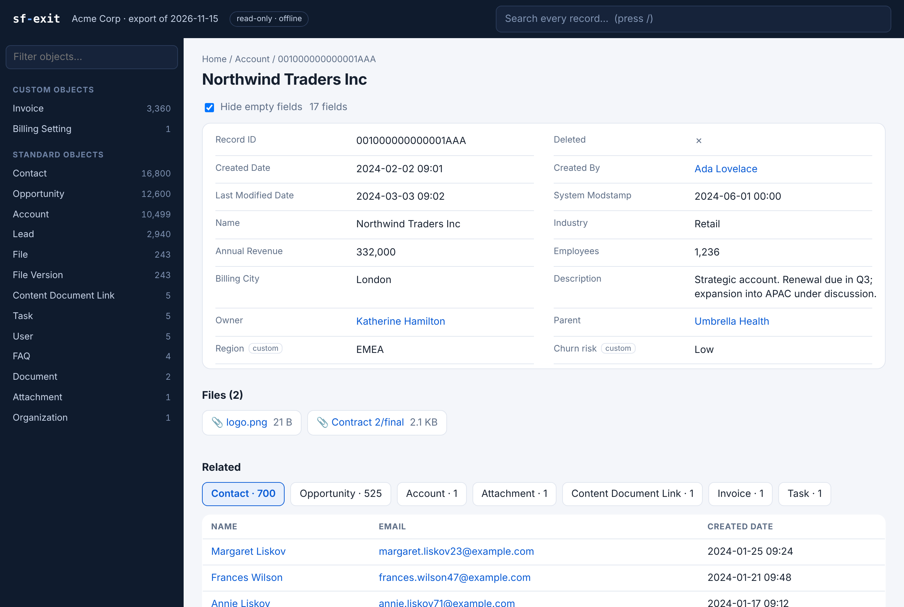
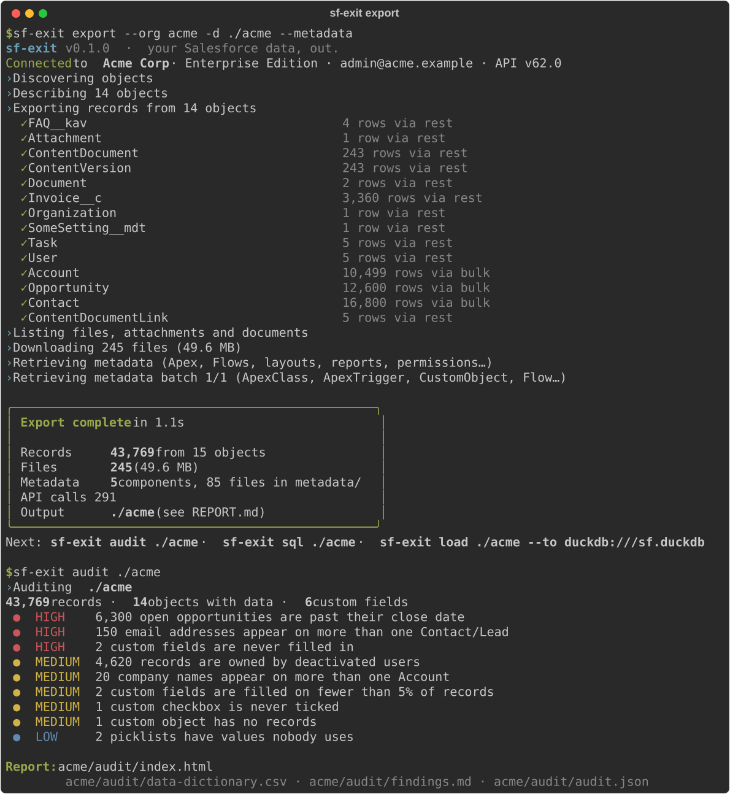
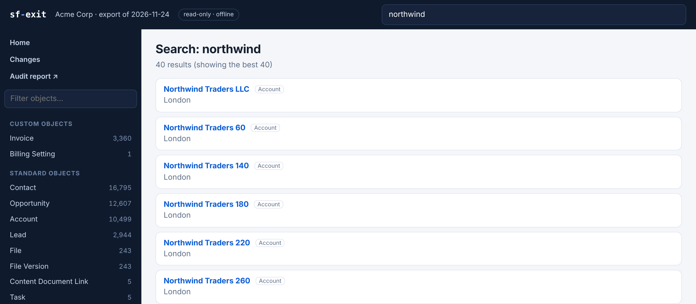
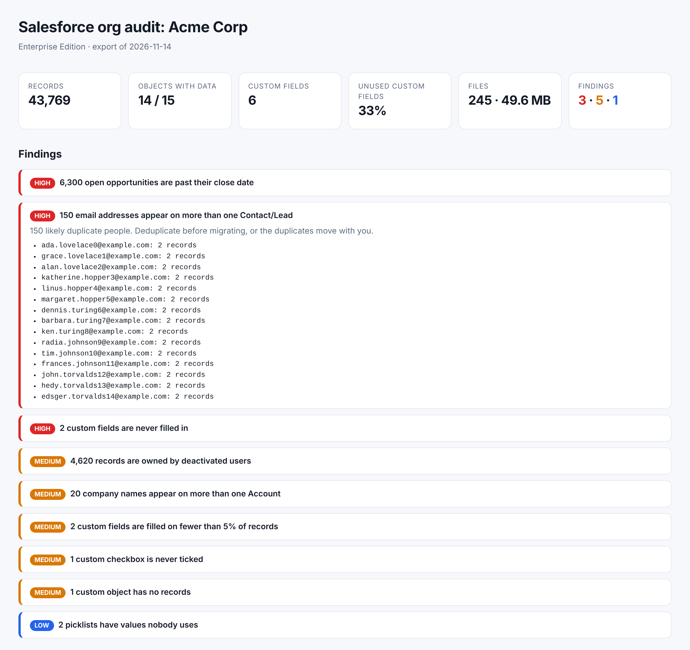
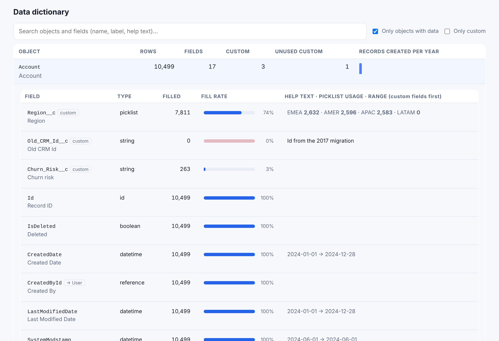
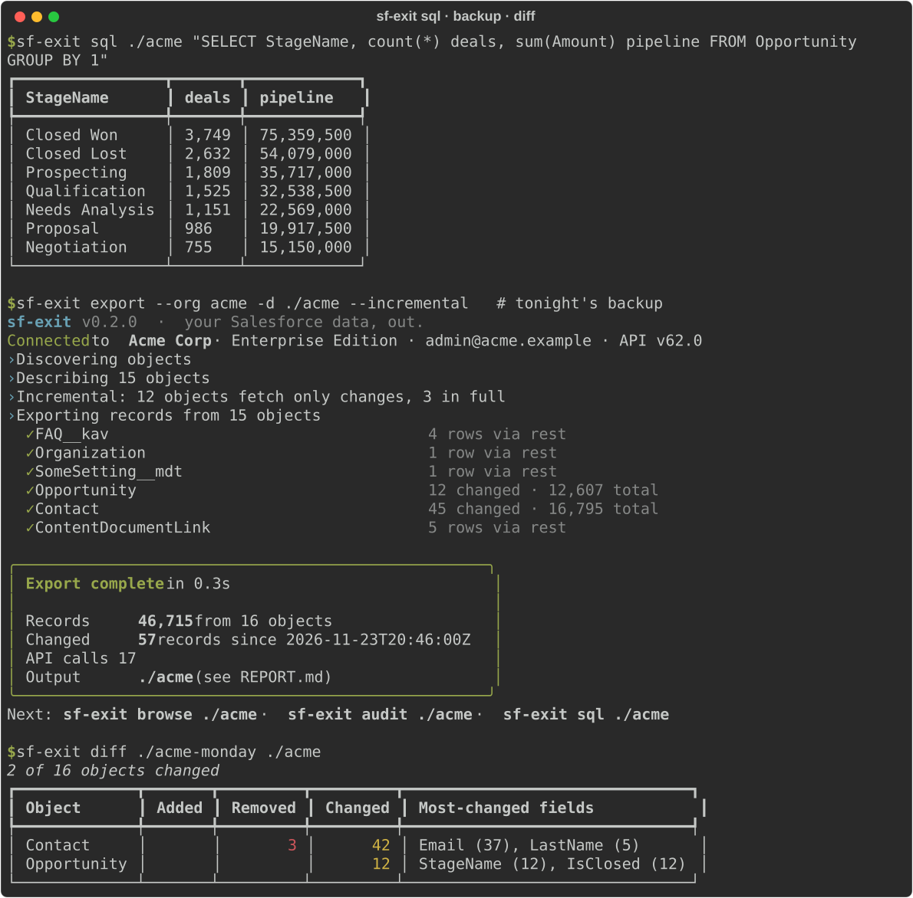
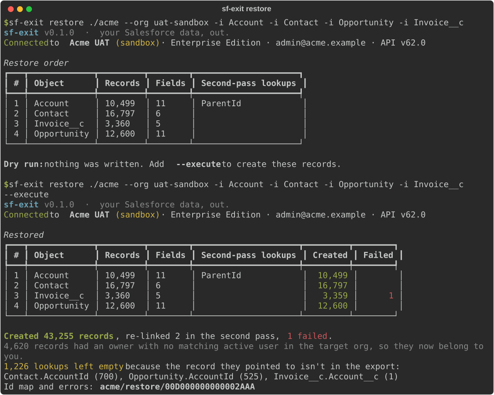
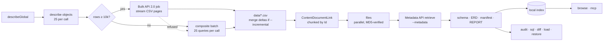

<div align="center">

# sf-exit

### Own your Salesforce data.

The open-source toolkit to **export** everything in a Salesforce org, **browse** it offline, **audit** what's really in there, **back it up** every night and **restore** it, all in open formats on your own disk.

[](https://github.com/akhsterminator/sf-exit/actions/workflows/ci.yml)
[](https://pypi.org/project/sf-exit/)
[](https://pypi.org/project/sf-exit/)
[](LICENSE)
[](https://github.com/akhsterminator/sf-exit/stargazers)

[Quick start](#quick-start) · [Browse](#browse-your-org-offline) · [Audit](#audit-whats-really-in-there) · [Backups](#nightly-backups-for-free) · [Restore](#restore-into-a-sandbox-or-a-new-org) · [AI](#ask-an-ai-about-your-crm) · [Commands](docs/commands.md) · [FAQ](#faq)



<sub>Your whole org, offline and read-only, after two commands. Screenshots and recordings are real runs against the simulated org used by the test suite (<code>scripts/record_demo.py</code>).</sub>

</div>

---

## Quick start

```bash
pipx install 'sf-exit[duckdb]'                # or: pip install / uvx sf-exit
sf org login web --alias my-org               # log in once with the Salesforce CLI
sf-exit export --org my-org -d ./export --metadata --audit
sf-exit browse ./export                       # click through it in your browser
```

That's every record, file and piece of configuration on your disk, plus a health report. There's no connected app to configure: sf-exit reuses your [Salesforce CLI](https://developer.salesforce.com/tools/salesforcecli) login. Token, JWT and client-credentials logins are covered in [docs/authentication.md](docs/authentication.md).

Want to look before you leap? `sf-exit plan --org my-org` estimates sizes and API calls, and `sf-exit doctor --org my-org` checks your permissions. Both are read-only.

## What it does

|  |  |
|---|---|
| 📦 **Export everything** | Every object, record and field, plus files, attachments and the links between them. Bulk API 2.0 for big objects, batched REST for small ones. Resumable. [→](docs/commands.md#export) |
| 🧬 **Export the configuration** | Apex, Flows, objects, layouts, reports, dashboards and permission sets as a deployable Metadata API folder. [→](docs/commands.md#metadata) |
| 🖥️ **Browse it offline** | A local web app over your export: record pages, related lists, files and full-text search. Like Salesforce, minus the subscription. [→](docs/browse.md) |
| 🩺 **Audit the org** | A health score, a searchable data dictionary and findings: unused fields, duplicates, stale pipeline, orphaned records. [→](docs/audit.md) |
| 🔁 **Back up incrementally** | Nightly runs fetch only what changed or was deleted. `sf-exit diff` shows exactly what changed, field by field. [→](docs/recipes/nightly-backups.md) |
| ♻️ **Restore** | Re-create records in a sandbox or a new org, parents first, with every lookup remapped. [→](docs/restore.md) |
| 🤖 **Ask an AI** | A built-in MCP server gives AI assistants read-only SQL, search and record tools over your export. [→](docs/ai-assistants.md) |
| 🔎 **Query it instantly** | `sf-exit sql ./export "SELECT …"`: typed SQL with no load step. [→](docs/commands.md#sql) |
| 🚚 **Load it anywhere** | DuckDB, Postgres, SQLite or Parquet with real column types, generated DDL and an ER diagram. [→](docs/commands.md#load) |
| 🔐 **Share it safely** | `--redact-pii` hashes emails, phones and other PII consistently, so joins and dedupe still work. [→](docs/commands.md#export) |

**Read-only by default. No telemetry. No servers.** Data goes straight from Salesforce to your disk. The one command that writes to Salesforce, `restore`, is a dry run unless you say otherwise.

<p align="center"></p>

## Browse your org offline

Cancelled the licences but legal still asks "what did that account look like"? `sf-exit browse` serves the export as a local, read-only web app: every object, sortable list views, record pages with lookups you can click, related lists, attached files and search across every record.

```bash
sf-exit browse ./export
```

<p align="center"></p>

It uses only the Python standard library, listens on localhost, and opens its index read-only. [More →](docs/browse.md)

## Audit what's really in there

`sf-exit audit` reads an export and produces a **health score**, a **searchable data dictionary** and a list of **findings**, entirely offline.

<p align="center"></p>

- **Which custom fields does nobody use?** Fill rates for every field, plus never-filled fields, never-ticked checkboxes, fields that always hold the same value and picklist values nobody picks.
- **How dirty is the data?** Duplicate contacts and leads by email, open leads that already exist as contacts, duplicate accounts by normalised company name.
- **What's rotting?** Open opportunities past their close date (with the total amount), records owned by deactivated users, custom objects untouched for a year.
- **How much has been built?** Apex classes and lines of code, Flows, layouts, reports and permission sets, counted from the metadata export.

<p align="center"></p>

You get one self-contained HTML file you can email, `data-dictionary.csv` for Excel, `findings.md` for tickets and `audit.json` for automation. [What each finding means →](docs/audit.md)

## Nightly backups, for free

Salesforce charges extra for backup, and third-party tools charge per user per month. sf-exit does it with a cron job or a scheduled GitHub Action and storage you already own.

```bash
sf-exit export --org prod -d ./backup --incremental    # only records changed or deleted since last night
sf-exit verify ./backup                                # every row count and checksum
sf-exit diff ./backup-yesterday ./backup               # what changed today, field by field
```

<p align="center"></p>

The complete GitHub Actions + S3 setup, with weekly full runs, point-in-time history and restore steps, is in [docs/recipes/nightly-backups.md](docs/recipes/nightly-backups.md). It also ships as an Action:

```yaml
- uses: akhsterminator/sf-exit@v0
  with:
    args: export -d sf-backup --incremental --include-deleted
  env:
    SF_INSTANCE_URL: ${{ secrets.SF_INSTANCE_URL }}
    SF_CLIENT_ID: ${{ secrets.SF_CLIENT_ID }}
    SF_CLIENT_SECRET: ${{ secrets.SF_CLIENT_SECRET }}
```

## Restore into a sandbox or a new org

A backup you can't restore is only an archive. `sf-exit restore` re-creates records in dependency order and rewrites every lookup to the new Ids, so accounts, contacts, opportunities and your custom objects arrive still connected. Use it to seed a sandbox with real data or to bring back what was deleted.

<p align="center"></p>

It shows a plan unless you add `--execute`, refuses production orgs unless you pass `--allow-production`, and can resume without creating duplicates. It's marked experimental: try it on a sandbox first. [Exactly what it does and doesn't do →](docs/restore.md)

## Ask an AI about your CRM

`sf-exit mcp ./export` is a [Model Context Protocol](https://modelcontextprotocol.io) server. Point any MCP-capable assistant at it and ask "which EMEA accounts have no open opportunities?" or "which custom fields look abandoned?". It works on the export, so the assistant never gets Salesforce credentials, can't change anything, and uses no API calls.

```json
{ "mcpServers": { "salesforce": { "command": "sf-exit", "args": ["mcp", "/path/to/export"] } } }
```

Tools: `list_objects`, `describe_object`, `query` (read-only SQL), `search`, `get_record`, `audit_findings`. [Set-up and privacy notes →](docs/ai-assistants.md)

## What you get

```text
export/
├── data/                     one CSV per object, every field, original 18-char Ids
│   ├── Account.csv
│   ├── Opportunity.csv
│   ├── Invoice__c.csv            custom objects, history, tasks, emails, Chatter, Knowledge…
│   └── ContentDocumentLink.csv   which file belongs to which record
├── files/                    every file, attachment and document, MD5-checked against Salesforce
│   └── index.csv                 file → record mapping
├── metadata/                 Apex, Flows, objects, layouts, reports… + package.xml   (--metadata)
├── audit/                    index.html, data-dictionary.csv, findings.md            (--audit)
├── changes/<timestamp>/      rows changed in each incremental run                    (--incremental)
├── restore/<org id>/         id-map.csv and errors.csv from each restore             (restore)
├── schema/Account.json       full describe: labels, picklists, relationships
├── schema.postgres.sql       ready-to-run DDL (also .duckdb.sql and .sqlite.sql)
├── erd.mmd                   Mermaid entity-relationship diagram
├── manifest.json             counts + SHA-256 checksums
└── REPORT.md                 what was exported, what was skipped and why
```

The format is documented in [docs/output-format.md](docs/output-format.md). It's plain CSV, so it outlives every tool, this one included.

## Recipes

| I want to… | Recipe |
|---|---|
| Move to HubSpot, Pipedrive, Attio, Twenty or Zoho | [Migrate to another CRM](docs/recipes/migrate-to-another-crm.md) |
| Stop paying for backups | [Free nightly backups](docs/recipes/nightly-backups.md) |
| Shut down an org but keep everything for legal | [Archive before shutdown](docs/recipes/archive-before-shutdown.md) |
| Fill a sandbox with realistic data | [Restore](docs/restore.md), with `--redact-pii` on the export |
| Run real SQL and BI on CRM data | [Postgres / DuckDB warehouse](docs/recipes/postgres-warehouse.md) |
| Let an assistant answer questions about the CRM | [AI assistants](docs/ai-assistants.md) |

## Why sf-exit

|                                              | **sf-exit** | Data Export Service | Data Loader | Paid backup tools |
|----------------------------------------------|:---:|:---:|:---:|:---:|
| Every object in one run                      | ✅ | ✅ | ❌ one at a time | ✅ |
| Files & attachments linked to their records  | ✅ | ✅ zipped | ❌ | ✅ |
| Configuration (Apex, Flows, layouts…)        | ✅ | ❌ | ❌ | some |
| Run whenever you want                        | ✅ | ❌ weekly or monthly | ✅ | ✅ |
| Incremental backups + diff between them      | ✅ | ❌ | ❌ | ✅ |
| Restore with relationships remapped          | ✅ experimental | ❌ | manual | ✅ |
| Browse the backup offline                    | ✅ | ❌ | ❌ | vendor portal |
| Org audit & data dictionary                  | ✅ | ❌ | ❌ | rarely |
| SQL, Postgres/DuckDB/Parquet, AI access      | ✅ | ❌ | ❌ | rarely |
| Resumable, checksummed, verifiable           | ✅ | ❌ | ❌ | varies |
| Data never leaves your machine               | ✅ | ✅ | ✅ | ❌ vendor-hosted |
| Price                                        | **free, MIT** | included | free | per user / month |

## Built to be trusted

- **Complete by default.** It finds every queryable object, including history, activities, Chatter, email, Knowledge and custom metadata, and every field. Objects Salesforce refuses to export unfiltered are handled (`ContentDocumentLink`, Knowledge `__kav`) or skipped with the reason written down.
- **Gentle on API limits.** Schemas and small objects are fetched **25 per API call**; large objects use Bulk API 2.0 jobs that cost a handful of calls whatever their size. `sf-exit plan` shows the cost before you start.
- **Resumable and verifiable.** Press Ctrl-C at any point and re-run to continue. Every CSV and file is SHA-256'd in `manifest.json`, file bodies are checked against Salesforce's own MD5, and `sf-exit verify --live` compares row counts with the org.
- **Fast where it counts.** Parallel object exports and file downloads; audit and diff use every CPU core on large exports.
- **Small and inspectable.** Three runtime dependencies. Browse, MCP, audit and diff are pure standard library.
- **Tested end to end.** The suite runs against an in-process simulated Salesforce (REST, Bulk API 2.0, composite, sObject collections and the Metadata API) on Linux, macOS and Windows, Python 3.10–3.14, plus a real Postgres.

## How it works



## Authentication

| Method | Command | Best for |
|---|---|---|
| Salesforce CLI | `sf-exit export --org my-alias` | Laptops. Zero setup. With no flags, your default CLI org is used |
| OAuth client credentials | `--instance-url … --client-id … --client-secret …` | Servers and CI ([setup](docs/authentication.md#client-credentials)) |
| JWT bearer | `--client-id … --username … --jwt-key-file server.key` | CI with certificates (`pip install 'sf-exit[jwt]'`) |
| Access token | `--instance-url … --access-token 00D…` | One-offs, other tools |
| Username + password | `--client-id … -u … --password 'pw+token'` | Legacy setups |

Every flag can also be set with an `SF_*` environment variable, for example `SF_ORG` or `SF_CLIENT_ID`. Add `--sandbox` for sandboxes. For a complete export, the user needs **View All Data** and **Query All Files**; `sf-exit doctor` checks.

## Install

```bash
pipx install sf-exit               # export, browse, audit, diff, restore, mcp, SQLite
pipx install 'sf-exit[duckdb]'     # + sf-exit sql, DuckDB and Parquet
pipx install 'sf-exit[all]'        # + Postgres and JWT login
docker run --rm -it -v "$PWD:/work" ghcr.io/akhsterminator/sf-exit --help
```

Python 3.10+ on macOS, Linux and Windows.

## FAQ

<details><summary><b>Will this use up my API limits?</b></summary>

Rarely by much. Small objects are fetched 25 per call, a Bulk API job costs a handful of calls however large it is, and each file costs one call. `sf-exit plan` shows the estimate against your remaining daily allowance before you start. Incremental backups usually take a few dozen calls plus one per new file.
</details>

<details><summary><b>Is it safe to run against production?</b></summary>

Yes. Every command except `restore` is read-only: the only write-style calls are Bulk API *query* jobs and Metadata API *retrieve* jobs. `restore` creates records, so it's a dry run by default and refuses production orgs unless you pass `--allow-production`. Use `--workers 1` to go gently on a busy org.
</details>

<details><summary><b>Which editions are supported?</b></summary>

Any org with API access: Enterprise, Unlimited, Performance and Developer editions, plus Professional Edition with the API add-on. Sandboxes work too.
</details>

<details><summary><b>How are deletions handled in incremental backups?</b></summary>

Incremental runs use `queryAll`, so records sent to the Recycle Bin since the last run are removed (or kept and flagged, with `--include-deleted`). Records already *purged* from the Recycle Bin are invisible to every API, so schedule a full export weekly. The [backup recipe](docs/recipes/nightly-backups.md) does this.
</details>

<details><summary><b>Does restore put files and metadata back too?</b></summary>

Not yet. It restores records. Metadata goes back with `sf project deploy start --metadata-dir ./export/metadata` (do that first), and files with Data Loader or the API, using `files/index.csv` and the restore's `id-map.csv` to re-link them. See [docs/restore.md](docs/restore.md).
</details>

<details><summary><b>Why are some objects skipped?</b></summary>

Some "objects" are metadata views (`FieldDefinition`), virtual roll-ups of data exported elsewhere (`OpenActivity`, `CombinedAttachment`), streaming events (`*ChangeEvent`) or external data (`__x`). Every skip and its reason is listed in `REPORT.md`.
</details>

<details><summary><b>Is my data sent anywhere?</b></summary>

No. sf-exit talks only to your Salesforce instance and writes only to your disk. There's no telemetry, account or server. The audit and the browser are generated and served locally. The one exception is your own choice: if you connect an AI assistant through `sf-exit mcp`, what it reads goes to that assistant's provider.
</details>

## Roadmap

- [x] Records, files and attachments, resumable
- [x] Metadata (Apex, Flows, layouts, reports…)
- [x] Incremental backups and `diff`
- [x] Org audit, health score and data dictionary
- [x] Offline browser
- [x] MCP server for AI assistants
- [x] Restore records with remapped relationships (experimental)
- [x] PII redaction
- [ ] Restore: files, upsert by external Id, point-in-time from `changes/`
- [ ] Write directly to S3 / GCS / Azure Blob
- [ ] Import helpers for HubSpot, Attio and Twenty
- [ ] Big object (`__b`) and Field Audit Trail export
- [ ] Browse: saved views and charts
- [ ] Single-file binaries (Homebrew, Scoop)

Ideas and requests are welcome: [open an issue](https://github.com/akhsterminator/sf-exit/issues/new/choose) or start a [discussion](https://github.com/akhsterminator/sf-exit/discussions). Easy starting points are labelled [good first issue](https://github.com/akhsterminator/sf-exit/labels/good%20first%20issue).

## Contributing

You don't need a Salesforce account to contribute: the whole test suite runs against the simulated org in `tests/fake_org.py`.

```bash
git clone https://github.com/akhsterminator/sf-exit && cd sf-exit
pip install -e '.[dev]'
pytest
```

See [CONTRIBUTING.md](CONTRIBUTING.md). The most valuable bug report is an object that fails in your org: paste the line from `REPORT.md`.

## License

[MIT](LICENSE). sf-exit is an independent open-source project and is not affiliated with, endorsed by or sponsored by Salesforce, Inc. Salesforce is a trademark of Salesforce, Inc.
