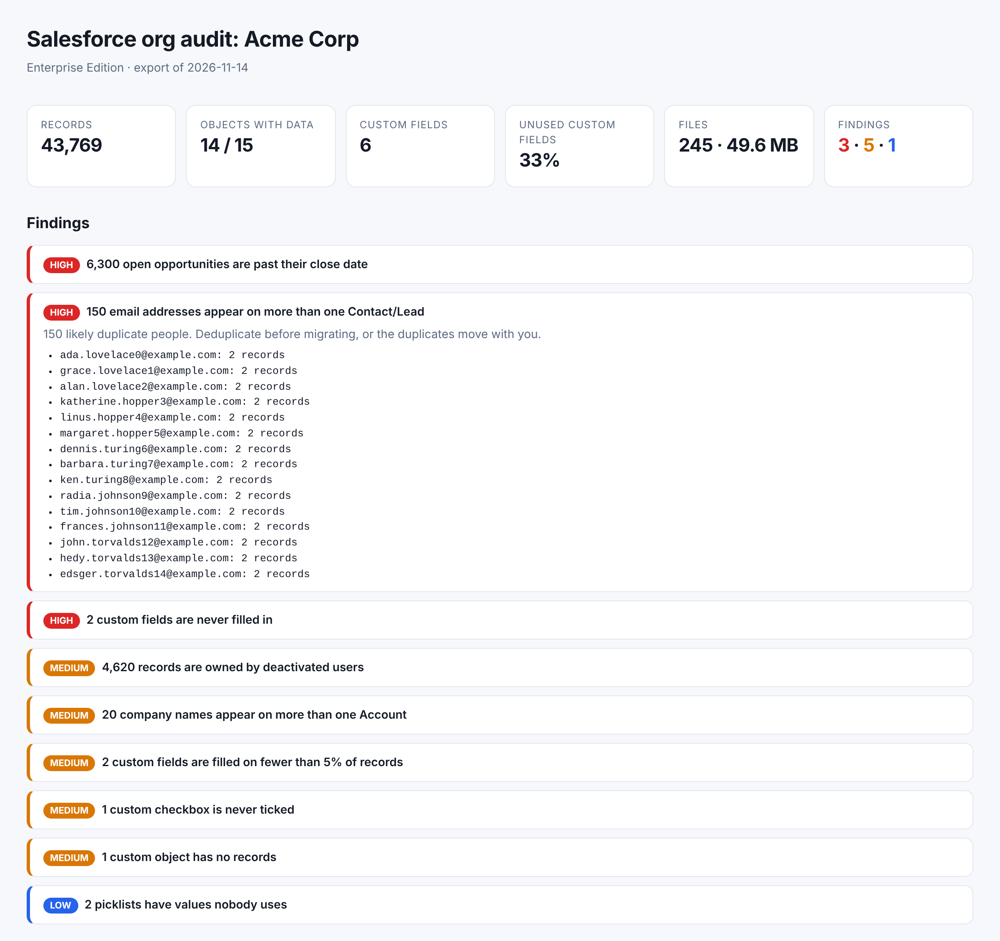

# sf-exit audit

`sf-exit audit ./export` turns an export into a **data dictionary** and an **org health report**. It runs entirely offline: no API calls, and nothing leaves your machine.

## Outputs

| File | Use it for |
|---|---|
| `audit/index.html` | The interactive report: summary, findings, and a searchable data dictionary with fill rates, picklist usage, help text and date ranges for every field |
| `audit/data-dictionary.csv` | Every object and field with label, type, formula flag, lookup targets, fill rate, help text and picklist values. Open it in Excel or Sheets, or hand it to a migration partner |
| `audit/findings.md` | Findings as Markdown, ready to paste into a ticket, a PR or a Slack thread |
| `audit/audit.json` | Everything, machine-readable |

## Findings

| Finding | Severity | Why it matters |
|---|---|---|
| Open opportunities past their close date | high | Stale pipeline inflates forecasts, and the total amount is shown |
| Email addresses on more than one Contact/Lead | high | Duplicates move with you in a migration, and cost money in marketing tools that bill per contact |
| Custom fields never filled in | high | Usually safe to delete. Fewer fields means simpler layouts, reports and migrations |
| Records owned by deactivated users | medium | Nobody is responsible for them, so reassign before migrating |
| Company names on more than one Account | medium | Matched ignoring case, punctuation and suffixes such as Inc, Ltd and LLC |
| Custom fields filled on fewer than 5% of records | medium | Often abandoned, or living on the wrong object |
| Custom checkboxes never ticked | medium | Every record still has the default value |
| Custom objects with no records | medium | Built but never used |
| Picklist values nobody uses | low | Shorter picklists make data entry faster and cleaner |
| Custom objects unchanged for over a year | low | Possibly abandoned, so check before migrating |
| Contacts not linked to an account | low | Private contacts are invisible to most users |
| Objects with 300+ custom fields | info | Approaching Salesforce's per-object field limit |

Fields aren't judged on objects with fewer than 20 records, and formula fields are never reported as unused.

## Tips

- Run it on a fresh export: `sf-exit export --org prod --audit`.
- Use `--redact-pii` on the export if you want to share the report outside your team. Duplicate detection still works on hashed emails.
- Schedule it alongside your backups and diff `audit.json` over time to see whether data quality is improving.
