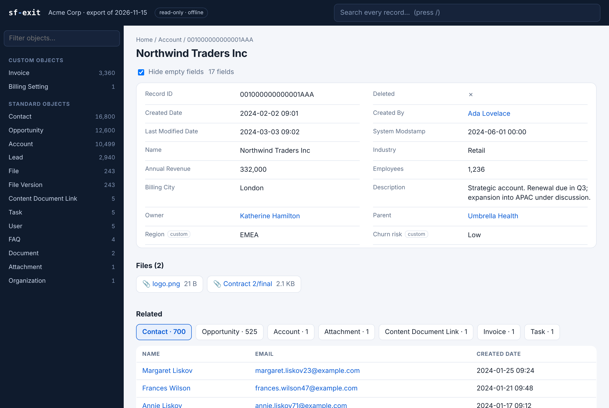
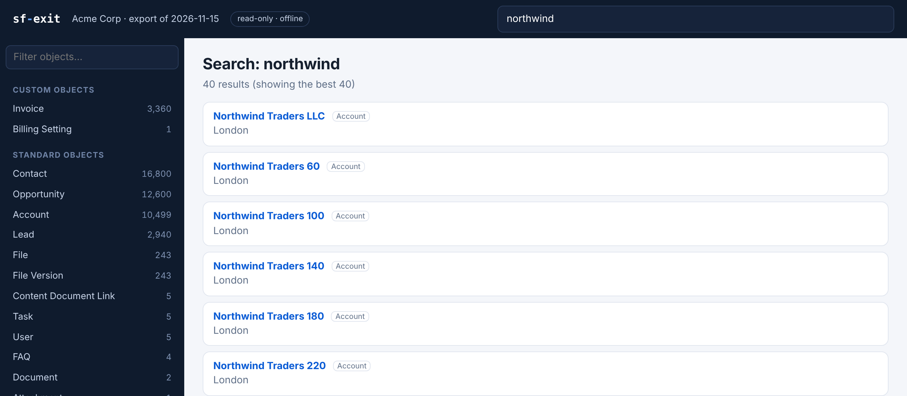

# sf-exit browse

`sf-exit browse ./export` opens your exported org in the browser: a read-only, offline copy you can click through the way you would in Salesforce. It's the fastest way to answer "what did that account look like?" after the licences have gone.



```bash
sf-exit browse ./export            # opens http://127.0.0.1:8484/
sf-exit browse ./export --port 0   # any free port
sf-exit browse ./export --no-open  # don't launch a browser (e.g. over SSH with a tunnel)
```

## What you get

- **Every object** in the sidebar with record counts, custom objects first.
- **List views** you can sort by any column and filter by name, with lookups shown as names.
- **Record pages** with every field (labels and help text from Salesforce), lookups as links, and empty fields hidden until you ask for them.
- **Related lists** for every relationship, both standard and custom, with counts.
- **Files**: attachments, documents and files linked to a record open or download in one click.
- **Search** across every record's name and key text fields (press `/`). It matches prefixes, so `north tra` finds "Northwind Traders".
- A link to the **audit report**, if you've run `sf-exit audit`.



## How it works

The first run builds a SQLite index at `<export>/.sf-exit/index.db`: one typed table per object, an index on every lookup column, and a full-text index. It's rebuilt automatically when the export changes, for example after an incremental backup. Expect it to take roughly as long as `sf-exit load` and to use about as much disk as the CSVs.

Everything is in the Python standard library, so there's nothing extra to install.

## Safety

- The server listens on `127.0.0.1` only and rejects requests with any other `Host` header.
- The index is opened read-only. No page or API call can change the export.
- Files are served only from the export's `files/` folder, and anything that isn't an image or PDF is downloaded, never rendered.
- Nothing is sent to Salesforce or anywhere else.

To share it with a colleague, don't expose the port. Copy the export folder, or use an SSH tunnel: `ssh -L 8484:127.0.0.1:8484 server`.
