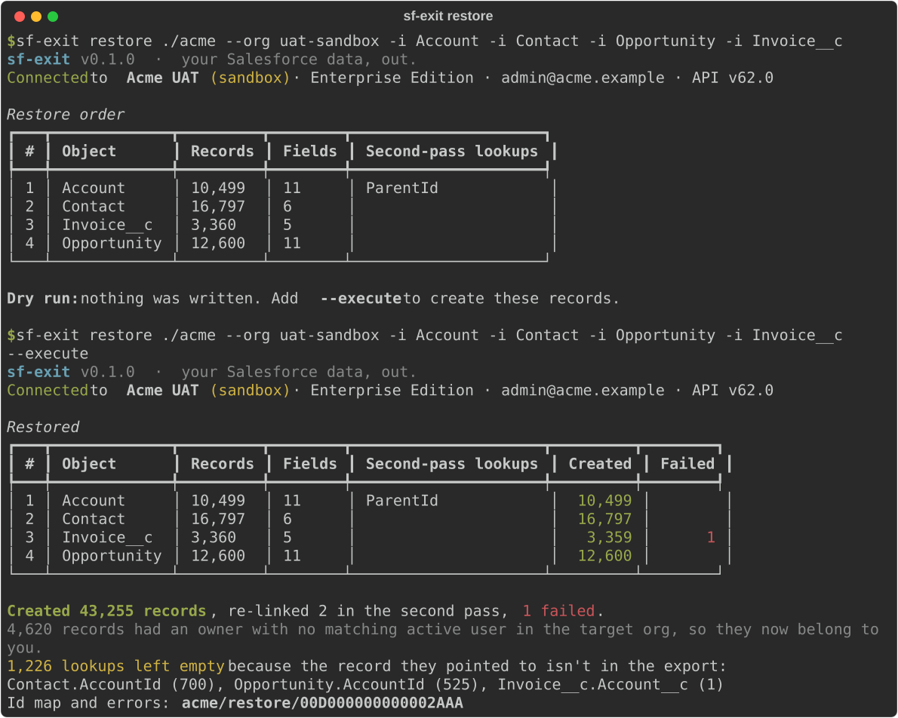

# sf-exit restore (experimental)

`sf-exit restore` re-creates records from an export in a Salesforce org, with their relationships intact. Use it to seed a sandbox with real data, rebuild an org, or bring back records that were deleted.

It is the only sf-exit command that writes to Salesforce, so it is careful by default:

- **Dry run unless you pass `--execute`.** Without it you only see the plan.
- **Sandboxes and Developer Edition orgs only**, unless you pass `--allow-production`.
- **Refuses the org the export came from** unless you pass `--allow-same-org`, because it creates new records and would duplicate anything that still exists.

It's marked experimental because Salesforce orgs vary enormously (validation rules, triggers, required fields). Always try it on a sandbox first.



## Usage

```bash
# 1. See the plan: order, record counts, fields, second-pass lookups
sf-exit restore ./export --org my-sandbox -i Account -i Contact -i Opportunity -i 'Invoice__c'

# 2. Do it
sf-exit restore ./export --org my-sandbox -i Account -i Contact -i Opportunity -i 'Invoice__c' --execute
```

`-i` takes globs, so `-i '*__c'` restores every custom object. Use `-x` to leave objects out.

## What it does

1. **Plans the order.** Objects are inserted parents-first, based on the lookups between the objects you chose.
2. **Inserts in batches of 200**, sending only fields that exist and are createable in the target. Formula, auto-number and system fields are left out, and fields missing from the target are listed.
3. **Remaps every lookup.** Each new record's Id is recorded against its old Id in `restore/<org id>/id-map.csv`, and child records are written with the new parent Ids.
4. **Second pass for backward links.** Self-references such as `Account.ParentId`, and lookups inside cycles, are filled in with an update once both records exist.
5. **Matches users and record types.** Owners are matched to active users in the target by username, then email. Unmatched owners default to you. Record types are matched by developer name.
6. **Logs failures** to `restore/<org id>/errors.csv` with Salesforce's error message, and carries on.

## Resuming

Re-run the same command. Records already in `id-map.csv` are skipped, so an interrupted restore continues without duplicates.

One caveat: writes are never retried automatically. If a batch times out, sf-exit can't know whether Salesforce processed it, so it records the batch as failed. Check the target org for those records before re-running.

## What it doesn't do (yet)

| Not restored | Use instead |
|---|---|
| Files and attachments | Data Loader, or the ContentVersion API, with `files/index.csv` and `id-map.csv` to re-link |
| Metadata (objects, fields, Apex, Flows) | `sf project deploy start --metadata-dir ./export/metadata`, **before** restoring records |
| Users, profiles, sharing rows, field history | Recreate users first so owners can be matched |
| Original Ids and created dates | New records get new Ids. Created dates need Salesforce's "Set Audit Fields" permission, which isn't used |
| Updating existing records (upsert) | Planned |

## Tips

- **Automation fires.** Triggers, flows and validation rules run on inserted records. In a sandbox, consider switching off email deliverability and noisy automation first.
- **Order of operations for a full rebuild:** deploy metadata → create users → `sf-exit restore`.
- **Lookups left empty** are reported at the end, by field. They point at records that weren't in the export (for example, deleted parents) or objects you didn't include.
